  

  <b>Software Development Engineer in Test II (SDET-2)</b> · Mobile · API · Fintech & Banking

  
  
  
  
  

---

### 🚀 About Me

SDET-2 with **3.5+ years** building Java-based test automation for mobile, web, and API layers in **fintech and banking**. At **Niyo**, I own quality for debit card onboarding and post-onboarding flows (KYC, card ordering, card configuration, transactions, reversals, settlements) for **DCB Bank** and **SBM Bank India**, including the pod-level QA go/no-go release sign-off.

- 📱 **Cross-platform mobile automation** with Appium Flutter Driver on Android and iOS
- 🔗 **API and event-driven testing** with REST Assured, Postman, and Apache Kafka producer/consumer validation
- 🤖 **AI-assisted testing** with LLM coding assistants (Kiro, Claude, Cursor) and read-only MCP integrations to Grafana and groundcover for debugging and RCA
- ⚙️ **CI/CD** with Jenkins pipelines, parallel execution, and Allure reporting

---

### 📊 Impact

| Metric | Result |
|---|---|
| 🛡️ P0 production escapes | **0** across 25+ releases |
| 📱 Mobile regression scenarios | **300+** on Android and iOS, flaky rate under 5% |
| ⏱️ Manual regression effort | Reduced by **40%** |
| 🔗 APIs under automated validation | **100+** across microservices and banking integrations |
| 🚦 Full regression per release candidate | Under **3 hours** in Jenkins |
| 🔍 Defect resolution time (MTTR) | Reduced by **~30%** with AI-assisted RCA |

---

### 🧰 Tech Stack

**Languages**

  
  
  

**Mobile and Web Automation**

  
  
  
  
  

**API and Backend**

  
  
  
  
  

**CI/CD, Cloud and Observability**

  
  
  
  
  
  

---

### 🧪 QA & Automation Expertise

- 🤖 **Automation frameworks:** Appium, Appium Flutter Driver, Selenium (Page Object Model, data-driven, hybrid)
- 🔗 **API testing:** REST Assured, Postman, Newman, JSON Schema validation
- 📨 **Event-driven testing:** Apache Kafka producer/consumer validation
- 🗄️ **Data validation:** SQL, Amazon DocumentDB, Redis state checks
- ⚙️ **CI/CD:** Jenkins, Docker, Maven, Selenium Grid, Allure and Extent Reports
- 🧠 **AI-assisted testing:** LLM assistants, Model Context Protocol (MCP), prompt engineering
- 📊 **Observability:** Grafana, groundcover, Kibana, Charles Proxy
- ♿ **Accessibility:** WCAG 2.1, JAWS, TalkBack

---

### 💼 Experience

<b>SDET-2 · Niyo (Finnew Solutions)</b> · Sep 2025 – Present

 

- Own end-to-end quality and release sign-off for debit card onboarding and post-onboarding in the Niyo Flutter app
- Built a Java mobile automation framework (Appium Flutter Driver, TestNG, Maven, POM) running on Android and iOS
- Validate Kafka card events, Redis state, and SQL/DocumentDB data beyond the UI
- Mentor teammates and review Appium and REST Assured test code before merge

<b>QA Engineer · Paytm Money and Paytm Services</b> · May 2023 – Sep 2025

 

- Built and maintained Selenium, Appium, and TestNG frameworks integrated with Jenkins
- Automated Sovereign Gold Bond and SIP workflows, cutting manual execution time by 40%
- Tested APIs with Postman and REST Assured for investment products

<b>Accessibility Tester · NTT DATA (client: SAP)</b> · Dec 2022 – Feb 2023

 

- Accessibility testing against WCAG 2.1 using screen readers

---

### 📂 Featured Projects

| Project | Tech Stack | Highlights |
|---------|-----------|------------|
| [**mobile-automation-framework**](https://github.com/Yogesh-Murugesan-QA/mobile-automation-framework) | Java, Appium Flutter Driver, TestNG, Maven | Cross-platform (Android + iOS) POM framework, data-driven via TestNG DataProvider, Allure reports |
| [**api-automation-rest-assured**](https://github.com/Yogesh-Murugesan-QA/api-automation-rest-assured) | Java, REST Assured, TestNG | API regression suite with JSON Schema validation and Jenkins integration |
| [**kafka-event-validation**](https://github.com/Yogesh-Murugesan-QA/kafka-event-validation) | Java, Apache Kafka, TestNG | Producer/consumer utilities validating event payloads in test environments |

---

### 📈 GitHub Insights

  
  

  

  <picture>
    <source media="(prefers-color-scheme: dark)" srcset="./profile/snake-dark.svg" />
    
  </picture>

---

### 🏆 Certifications

- 🏅 ISTQB Certified Tester, Foundation Level (CTFL)
- 📜 Software Testing Certification, QSpiders

---

<i>"Software is great when it works. It's amazing when it's tested well."</i>

